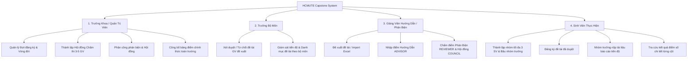

# 🎓 HCMUTE Capstone Management System
> **Hệ thống Quản lý Đề tài Tốt nghiệp & Khóa luận Sinh viên — Đại học Sư phạm Kỹ thuật TP.HCM (HCMUTE)**

[](https://adoptium.net/)
[](https://spring.io/projects/spring-boot)
[](https://www.mysql.com/)
[](https://flywaydb.org/)
[](https://www.cloudflare.com/developer-platform/r2/)
[](https://getbootstrap.com/)
[](#-kiểm-thử-tự-động-test-suite)

---

## 📌 Giới thiệu dự án

**HCMUTE Capstone Management** là giải pháp phần mềm chuyên sâu quản lý toàn diện quy trình làm Khóa luận Tốt nghiệp (KLTN), Nghiên cứu Khoa học (NCKH) và Tiểu luận Chuyên ngành (TLCN) dành cho Khoa Công nghệ Thông tin - Trường Đại học Sư phạm Kỹ thuật TP.HCM.

Hệ thống được thiết kế theo tư duy **Domain-Driven Integrity** với mô hình **phòng thủ 2 lớp (Java Domain Service Guards + Database Constraints)**, đảm bảo tính công bằng học thuật tuyệt đối, ngăn chặn gian lận, xung đột dữ liệu và đem lại trải nghiệm giao diện người dùng phong cách **Neo-Brutalism** sắc nét, dứt khoát và hiện đại.

---

## 🏛️ Kiến trúc & Công nghệ (Tech Stack)

### Backend & Database
- **Ngôn ngữ:** Java 21 (LTS)
- **Framework nền tảng:** Spring Boot 3.3.4
  - **Spring Security 6:** Phân quyền dựa trên RBAC (`ROLE_ADMIN`, `ROLE_DEPARTMENT_HEAD`, `ROLE_LECTURER`, `ROLE_STUDENT`).
  - **Spring Data JPA / Hibernate Core:** Ánh xạ thực thể quan hệ, quản lý Composite Key an toàn.
  - **Thymeleaf:** Server-side Rendering tích hợp Spring Security Taglib.
  - **Apache POI:** Nhập/Xuất đề tài từ tệp Excel chuẩn hóa.
- **Lưu trữ đám mây:** Cloudflare R2 (S3-Compatible Protocol qua AWS SDK v2) hỗ trợ lưu trữ tệp báo cáo sinh viên phân tán.
- **Cơ sở dữ liệu:** MySQL 8.x (Flyway schema migrations versioned V1 -> V4).
- **Kiểm thử tự động:** JUnit 5, Mockito, Spring Boot Test, H2 In-Memory Database.

### Frontend & UI/UX Design System
- **Triết lý thiết kế:** **Neo-Brutalism Design** (Độ tương phản cao, viền dày cứng cáp 2.5px - 3px, đổ bóng sắc nét `box-shadow: 4px 4px 0px #000`, nút ấn bấm lún tương tác thực).
- **Hệ thống Modal & Stepper tùy biến:**
  - Hộp thoại xác nhận bất đồng bộ `openNbConfirm()` thay thế hoàn toàn hộp thoại `confirm()` mặc định của trình duyệt.
  - Neo-Brutalism Stepper hiển thị trực quan 4 giai đoạn làm đồ án của sinh viên.

---

## ⚙️ Các Phân Hệ Chức Năng (RBAC Matrix)



### 1. Phân hệ Quản trị viên / Trưởng Khoa (`ROLE_ADMIN`)
- **Quản lý Đợt đăng ký:** Kiểm soát máy trạng thái (`DRAFT` ➔ `OPEN_LECTURER` ➔ `OPEN_STUDENT` ➔ `IN_PROGRESS` ➔ `REVIEWING` ➔ `DEFENSE` ➔ `CLOSED`).
- **Thành lập Hội Đồng:** Tạo hội đồng 3–5 thành viên (Chủ tịch, Thư ký, Ủy viên) bằng JPA Cascade Persist an toàn, phân công đề tài bảo vệ.
- **Thống kê Dashboard KPI:** Thẻ số liệu thời gian thực (Tổng số đề tài, Nhóm sinh viên, Đợt khóa, Người dùng).
- **Công bố Kết quả Điểm:** Phê duyệt điểm cuối cùng, xuất bảng điểm học tập.

### 2. Phân hệ Trưởng Bộ Môn (`ROLE_DEPARTMENT_HEAD`)
- **Thẩm định đề tài:** Kiểm tra nội dung, mục tiêu nghiên cứu và yêu cầu kỹ thuật do giảng viên đề xuất. Phê duyệt (`APPROVED`) hoặc Từ chối kèm lý do phản hồi chi tiết (`REJECTED`).
- **Tra cứu danh mục:** Theo dõi số lượng đề tài theo từng bộ môn quản lý.

### 3. Phân hệ Giảng Viên (`ROLE_LECTURER`)
- **Quản lý đề tài cá nhân:** Đề xuất đề tài mới (hỗ trợ 1 GVHD chính + 1 GV đồng hướng dẫn), sửa đề tài khi bị trả về, xóa đề tài chưa duyệt. Hỗ trợ import nhanh hàng loạt từ Excel.
- **Academic Integrity Guard (Nguyên tắc liêm chính học thuật):**
  - **Điểm Hướng Dẫn (`ADVISOR`):** Chỉ GVHD của đề tài mới có quyền nhập điểm hướng dẫn.
  - **Điểm Phản Biện (`REVIEWER`):** Giảng viên được Trưởng khoa phân công chấm phản biện độc lập (nghiêm cấm GV tự chấm phản biện đề tài của mình).
  - **Điểm Hội Đồng (`COUNCIL`):** Thành viên hội đồng nhập điểm bảo vệ tại buổi lễ (nghiêm cấm GVHD ngồi chấm hội đồng cho đề tài mình hướng dẫn).

### 4. Phân hệ Sinh Viên (`ROLE_STUDENT`)
- **Quản lý Nhóm sinh viên:**
  - Tạo nhóm hoặc tham gia qua mã nhóm, tối đa 3 thành viên/nhóm.
  - Phân quyền Trưởng nhóm / Thành viên rõ ràng.
  - Tự động lưu vết và ưu tiên hiển thị nhóm ngay cả khi đợt đăng ký đã đóng.
- **Đăng ký Đề tài:** Chọn đề tài đã được Bộ môn phê duyệt trong thời gian mở cổng.
- **Nộp Báo Cáo:** Chỉ Nhóm trưởng đại diện nộp tài liệu (.pdf, .docx, .zip) lên Cloudflare R2; khóa form nộp tự động khi đợt đã đóng hoặc chưa mở.
- **Tra cứu Điểm:** Xem chi tiết điểm Hướng dẫn, Điểm phản biện, Điểm hội đồng và nhận xét của từng giảng viên.

---

## 🛡️ Các Chốt Chặn Nghiệp Vụ Cốt Lõi (Business Invariants)

| Nghiệp vụ | Chốt chặn Backend & Database | Trải nghiệm UI/UX |
| :--- | :--- | :--- |
| **Thành lập Hội đồng** | Sử dụng `CouncilMemberId(null, lecturerId)` kết hợp `@MapsId` và JPA Cascade; kiểm tra ràng buộc một GV không kiêm nhiệm 2 vai trò trong 1 hội đồng. | Modal xác nhận giải tán hội đồng qua `openNbConfirm`. |
| **Quyền chấm điểm** | Kiểm tra logic: `isAdvisor` chỉ được chấm `ADVISOR`; `isReviewer` chỉ được chấm `REVIEWER`; `isCouncilMember` chỉ được chấm `COUNCIL`. Ngăn chặn hoàn toàn xung đột lợi ích. | Tách riêng 3 tab đề tài: Hướng dẫn, Đề tài Phản biện, Đề tài Hội đồng. |
| **Nộp báo cáo** | Chặn ở Service: Nhóm phải có đề tài, đợt phải ở trạng thái cho phép nộp, người gửi phải có cờ `isLeader = true`. | Hiển thị thông báo trạng thái đợt và ẩn form tải tệp đối với thành viên thường. |
| **Đăng ký / Hủy nhóm** | Chặn giải tán nhóm hoặc hủy đề tài khi đợt không còn ở trạng thái `OPEN_STUDENT` hoặc đề tài đã bước vào giai đoạn thực hiện. | Vô hiệu hóa nút bấm và hiện cảnh báo giải thích lý do rõ ràng. |

---

## 🧪 Kiểm Thử Tự Động (Test Suite)

Dự án được bao phủ bằng bộ kiểm thử tự động toàn diện:

```bash
mvn test
```

```
[INFO] Running vn.edu.ute.capstone.service.EvaluationServiceTest
[INFO] Tests run: 5, Failures: 0, Errors: 0, Skipped: 0 -- in vn.edu.ute.capstone.service.EvaluationServiceTest
[INFO] Running vn.edu.ute.capstone.service.TopicServiceTest
[INFO] Tests run: 5, Failures: 0, Errors: 0, Skipped: 0 -- in vn.edu.ute.capstone.service.TopicServiceTest
[INFO] Running vn.edu.ute.capstone.service.StudentGroupServiceTest
[INFO] Tests run: 4, Failures: 0, Errors: 0, Skipped: 0 -- in vn.edu.ute.capstone.service.StudentGroupServiceTest
[INFO] Running vn.edu.ute.capstone.service.SubmissionServiceTest
[INFO] Tests run: 3, Failures: 0, Errors: 0, Skipped: 0 -- in vn.edu.ute.capstone.service.SubmissionServiceTest
[INFO] Running vn.edu.ute.capstone.UteCapstoneManagementApplicationTests
[INFO] Tests run: 1, Failures: 0, Errors: 0, Skipped: 0 -- in vn.edu.ute.capstone.UteCapstoneManagementApplicationTests
[INFO] ------------------------------------------------------------------------
[INFO] BUILD SUCCESS (18/18 Tests Passed - 100%)
[INFO] ------------------------------------------------------------------------
```

---

## 🚀 Hướng Dẫn Cài Đặt & Triển Khai (Quickstart)

### 1. Yêu cầu tiên quyết
- **Java:** JDK 21 trở lên
- **Maven:** 3.8+ (hoặc wrapper `./mvnw`)
- **MySQL:** Phiên bản 8.0+

### 2. Thiết lập Cơ sở dữ liệu
Khởi tạo database MySQL với bộ mã ký tự tiếng Việt đầy đủ:
```sql
CREATE DATABASE ute_capstone_db CHARACTER SET utf8mb4 COLLATE utf8mb4_unicode_ci;
```

### 3. Cấu hình Môi trường
Tạo file `.env` hoặc chỉnh sửa file `src/main/resources/application.properties`:
```properties
# Database Configuration
spring.datasource.url=jdbc:mysql://localhost:3306/ute_capstone_db?useSSL=false&serverTimezone=UTC&allowPublicKeyRetrieval=true
spring.datasource.username=root
spring.datasource.password=your_password

# Flyway Migration
spring.flyway.enabled=true
spring.flyway.baseline-on-migrate=true

# Cloudflare R2 (Optional nếu dùng local mock)
cloudflare.r2.endpoint=https://<account-id>.r2.cloudflarestorage.com
cloudflare.r2.access-key=<your-access-key>
cloudflare.r2.secret-key=<your-secret-key>
cloudflare.r2.bucket=ute-capstone-submissions
```

### 4. Khởi chạy Ứng dụng
```bash
# Build và chạy ứng dụng
mvn spring-boot:run
```
Ứng dụng sẽ tự động chạy Flyway migrate và khởi động tại: `http://localhost:8080`

### 5. Tài khoản dùng thử mặc định (Seed Data)
| Tên đăng nhập | Mật khẩu | Phân quyền | Vai trò | Họ và tên |
| :--- | :--- | :--- | :--- | :--- |
| `truongkhoa` | `123456` | `ROLE_ADMIN` | Trưởng Khoa / Quản trị hệ thống | PGS.TS Nguyễn Văn Trưởng Khoa |
| `head_cnpm` | `123456` | `ROLE_DEPARTMENT_HEAD` | Trưởng Bộ môn CNPM | TS. Trần Văn Trưởng Bộ Môn |
| `gv_minh` | `123456` | `ROLE_LECTURER` | Giảng viên hướng dẫn | ThS. Lê Quang Minh |
| `gv_nam` | `123456` | `ROLE_LECTURER` | Giảng viên phản biện / HĐ | TS. Hoàng Nam |
| `sv_nghia` | `123456` | `ROLE_STUDENT` | Sinh viên (Nhóm trưởng) | Đặng Đại Nghĩa |
| `sv_anh` | `123456` | `ROLE_STUDENT` | Sinh viên (Thành viên) | Nguyễn Tuấn Anh |

---

## 📄 Báo Cáo Kỹ Thuật (Technical Documentation)
Dự án đi kèm tài liệu báo cáo kỹ thuật chính thức dạng văn bản Word:
- Tệp tin: `BAO_CAO_SUA_LOI_KY_THUAT.docx` (Font Times New Roman, Size 13pt, chuẩn hành chính).
- Tự động xuất bằng: `python generate_report_docx.py` hoặc `run_create_report.bat`.

---

## 👥 Tác Giả & Bản Quyền
- **Dự án:** HCMUTE Capstone Management System
- **Khoa Công nghệ Thông tin** — Trường Đại học Sư phạm Kỹ thuật TP.HCM (HCMUTE)
- Giữ toàn quyền phát triển và bảo lưu mọi quyền liên quan theo quy định của nhà trường.
