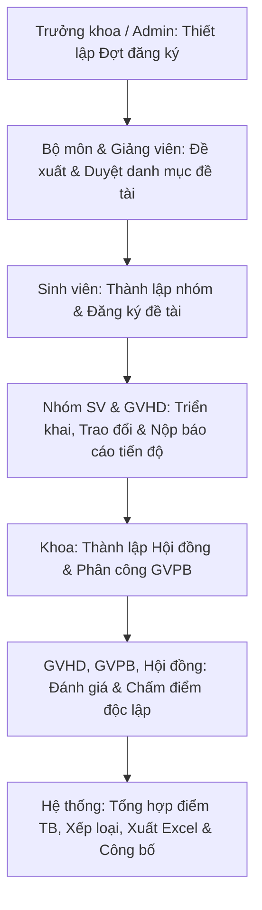

# BÁO CÁO TOÀN DIỆN VỀ KIẾN TRÚC, CÁC CẢI TIẾN HỆ THỐNG VÀ XỬ LÝ LỖI KỸ THUẬT
## HỆ THỐNG QUẢN LÝ ĐỀ TÀI TỐT NGHIỆP & NGHIÊN CỨU KHOA HỌC (HCMUTE CAPSTONE MANAGEMENT)

---

> [!NOTE]
> **Văn bản báo cáo kỹ thuật học thuật**  
> **Dự án:** HCMUTE Capstone Management System  
> **Khoa:** Công nghệ Thông tin - Trường Đại học Sư phạm Kỹ thuật TP.HCM (HCMUTE)  
> **Kiến trúc:** Clean Architecture / Layered Architecture trên nền tảng Spring Boot 4.1.1 (Java 21 LTS) & Thymeleaf  
> **Trạng thái kiểm thử:** 18/18 Unit & Integration Tests Passed (100%) | Schema Migration: Flyway V7

---

## MỤC LỤC
1. [TỔNG QUAN HỆ THỐNG & BỐI CẢNH DỰ ÁN](#1-tổng-quan-hệ-thống--bối-cảnh-dự-án)
2. [CHI TIẾT CÁC TÍNH NĂNG MỚI ĐÃ TRIỂN KHAI THEO BACKLOG](#2-chi-tiết-các-tính-năng-mới-đã-triển-khai-theo-backlog)
   - [2.1 Hạng mục 1: Xuất bảng điểm tổng kết ra Excel (.xlsx)](#21-hạng-mục-1-xuất-bảng-điểm-tổng-kết-ra-excel-xlsx)
   - [2.2 Hạng mục 2: Kênh trao đổi & phản hồi báo cáo giữa GVHD và Sinh viên](#22-hạng-mục-2-kênh-trao-đổi--phản-hồi-báo-cáo-giữa-gvhd-và-sinh-viên)
   - [2.3 Hạng mục 3: Hệ thống thông báo nội bộ & Email Alert bất đồng bộ](#23-hạng-mục-3-hệ-thống-thông-báo-nội-bộ--email-alert-bất-đồng-bộ)
   - [2.4 Hạng mục 4: Biểu đồ thống kê trực quan trên Dashboard](#24-hạng-mục-4-biểu-đồ-thống-kê-trực-quan-trên-dashboard)
   - [2.5 Hạng mục 5: Bộ lọc & Tìm kiếm tức thì (Instant Live Search)](#25-hạng-mục-5-bộ-lọc--tìm-kiếm-tức-thì-instant-live-search)
3. [HỆ THỐNG THIẾT KẾ ĐỒNG BỘ TOÀN DỰ ÁN (DESIGN SYSTEM & UX CONSOLIDATION)](#3-hệ-thống-thiết-kế-đồng-bộ-toàn-dự-án-design-system--ux-consolidation)
   - [3.1 Chuẩn hóa phân trang hệ thống (Reusable Pagination Fragment)](#31-chuẩn-hóa-phân-trang-hệ-thống-reusable-pagination-fragment)
   - [3.2 Hệ thống thông báo tương tác (Flash Alerts Design Tokens)](#32-hệ-thống-thông-báo-tương-tác-flash-alerts-design-tokens)
   - [3.3 Hộp thoại xác nhận Neo-Brutalism Modal (`openNbConfirm`)](#33-hộp-thoại-xác-nhận-neo-brutalism-modal-opennbconfirm)
   - [3.4 Kiến trúc điều hướng & Breadcrumbs nhất quán](#34-kiến-trúc-điều-hướng--breadcrumbs-nhất-quán)
4. [PHÂN TÍCH NGUYÊN NHÂN GỐC RỄ & PHƯƠNG ÁN XỬ LÝ CÁC LỖI ĐÃ PHÁT SINH (ROOT CAUSE ANALYSIS & RESOLUTION)](#4-phân-tích-nguyên-nhân-gốc-rễ--phương-án-xử-lý-các-lỗi-đã-phát-sinh-root-cause-analysis--resolution)
   - [4.1 Lỗi can thiệp dữ liệu sinh viên ngoài Khoa (Faculty Isolation Breach)](#41-lỗi-can-thiệp-dữ-liệu-sinh-viên-ngoài-khoa-faculty-isolation-breach)
   - [4.2 Lỗi 404 khi truy cập mô-đun Quản trị Người dùng](#42-lỗi-404-khi-truy-cập-mô-đun-quản-trị-người-dùng)
   - [4.3 Lỗi giao diện mất nút quay về Dashboard trong User Management](#43-lỗi-giao-diện-mất-nút-quay-về-dashboard-trong-user-management)
   - [4.4 Lỗi 500 Hibernate Session Conflict tại Hội đồng Phản biện (`NonUniqueObjectException`)](#44-lỗi-500-hibernate-session-conflict-tại-hội-đồng-phản-biện-nonuniqueobjectexception)
   - [4.5 Lỗi Giảng viên không xóa được đề tài chưa duyệt hoặc bị từ chối](#45-lỗi-giảng-viên-không-xóa-được-đề-tài-chưa-duyệt-hoặc-bị-từ-chối)
   - [4.6 Lỗi 500 khi Login / vào Dashboard do gọi nhầm Getter của Enum `TopicStatus`](#46-lỗi-500-khi-login--vào-dashboard-do-gọi-nhầm-getter-của-enum-topicstatus)
5. [KẾT QUẢ KIỂM THỬ TOÀN DIỆN & TRẠNG THÁI TRIỂN KHAI](#5-kết-quả-kiểm-thử-toàn-diện--trạng-thái-triển-khai)

---

## 1. TỔNG QUAN HỆ THỐNG & BỐI CẢNH DỰ ÁN

Hệ thống **HCMUTE Capstone Management** là giải pháp phần mềm quản trị học thuật chuyên biệt phục vụ Khoa Công nghệ Thông tin - Trường Đại học Sư phạm Kỹ thuật TP.HCM. Dự án số hóa và tự động hóa toàn bộ vòng đời quản lý đề tài học thuật gồm 4 loại hình:
1. Đề tài Môn học (`COURSE`)
2. Nghiên cứu khoa học sinh viên (`RESEARCH`)
3. Tiểu luận chuyên ngành (`ESSAY`)
4. Khóa luận tốt nghiệp (`CAPSTONE`)

### Quy trình nghiệp vụ khép kín (End-to-End Workflow)


### Các tác nhân hệ thống và phân cấp thẩm quyền
- **Trưởng khoa / Admin (Dean / Administrator):** Khởi tạo đợt, kiểm soát phạm vi khoa, phê duyệt cấp cao, thành lập hội đồng phản biện và công bố kết quả.
- **Trưởng bộ môn (Department Head):** Thẩm định chuyên môn và duyệt đề tài thuộc phạm vi bộ môn quản lý.
- **Giảng viên (Lecturer / Advisor / Reviewer / Council Member):** Đề xuất đề tài hướng dẫn, phản hồi báo cáo tiến độ của sinh viên, tham gia chấm điểm phản biện hoặc hội đồng (tuân thủ quy chế chống xung đột lợi ích).
- **Sinh viên (Student):** Lập nhóm tối đa 3 thành viên, nhóm trưởng đại diện đăng ký đề tài, nộp báo cáo định kỳ và tra cứu kết quả đánh giá.

---

## 2. CHI TIẾT CÁC TÍNH NĂNG MỚI ĐÃ TRIỂN KHAI THEO BACKLOG

### 2.1 Hạng mục 1: Xuất bảng điểm tổng kết ra Excel (.xlsx)
- **Công nghệ triển khai:** Apache POI (`poi-ooxml` phiên bản mới nhất).
- **Tầng dịch vụ:** `vn.edu.ute.capstone.service.impl.ExcelServiceImpl#exportResultsToExcel(Long periodId)`.
- **Cấu trúc bảng điểm chuẩn hóa:**
  - Tiêu đề cột chuẩn: *STT, Mã đề tài, Tên đề tài, Bộ môn, Mã nhóm, Danh sách sinh viên (kèm MSSV & chức danh Trưởng nhóm), Giảng viên hướng dẫn (chính & đồng hướng dẫn), Điểm hướng dẫn, Điểm phản biện (kèm tên GVPB), Điểm hội đồng (kèm tên từng thành viên), Điểm trung bình tích lũy, Xếp loại học thuật*.
- **Quy tắc xếp loại học thuật tự động:**
  - $\ge 8.50$: **GIỎI**
  - $\ge 7.00$ và $< 8.50$: **KHÁ**
  - $\ge 5.00$ và $< 7.00$: **ĐẠT**
  - $< 5.00$: **KHÔNG ĐẠT**
- **Định dạng trực quan:** Header nền đen viền đậm theo chuẩn Neo-Brutalism B&W, phông chữ đồng nhất, tự động co giãn kích thước cột (`autoSizeColumn`), định dạng số điểm với 2 chữ số thập phân (`0.00`).
- **Phân quyền truy cập:** Endpoint `/admin/publish/export-excel` được bảo vệ nghiêm ngặt bằng Spring Security chỉ cho phép `ADMIN` và cấp quản lý bộ môn trích xuất dữ liệu.

### 2.2 Hạng mục 2: Kênh trao đổi & phản hồi báo cáo giữa GVHD và Sinh viên
- **Schema Migration:** Tạo script Flyway `V7__add_submission_feedback.sql`:
  ```sql
  ALTER TABLE submissions
  ADD COLUMN feedback TEXT NULL,
  ADD COLUMN review_status VARCHAR(50) NOT NULL DEFAULT 'PENDING',
  ADD COLUMN reviewed_at DATETIME NULL;
  ```
- **Mô hình trạng thái ReviewStatus:** `PENDING` (Chờ xem xét), `ACCEPTED` (Đạt yêu cầu / Thông qua), `REVISE_REQUIRED` (Yêu cầu chỉnh sửa lại).
- **Trải nghiệm người dùng:**
  - Giảng viên hướng dẫn có modal chuyên dụng nhập nội dung góp ý chi tiết, cập nhật trực tiếp vào từng bản nộp tiến độ.
  - Sinh viên theo dõi lịch sử nộp bài được gắn Badge trạng thái màu trực quan kèm khung nhận xét của GVHD để kịp thời sửa đổi trước khi nộp báo cáo cuối kỳ.
- **Chốt chặn phân quyền (Authorization Guard):** Chỉ GVHD chính thức của đề tài hoặc Quản trị viên mới có quyền cập nhật nhận xét và chuyển trạng thái đánh giá bản nộp.

### 2.3 Hạng mục 3: Hệ thống thông báo nội bộ & Email Alert bất đồng bộ
- **Kiến trúc:** Triển khai qua `EmailNotificationService` & `EmailNotificationServiceImpl` tận dụng `@Async` của Spring Framework, chạy trên thread pool riêng biệt nhằm đảm bảo **Non-blocking UI**.
- **Cơ chế Fail-safe:**
  - Tích hợp khối `try-catch` bọc quanh lệnh `mailSender.send()`.
  - Trong trường hợp hạ tầng mạng nội bộ hoặc cấu hình SMTP chưa khai báo thông tin mật khẩu thực tế, hệ thống tự động ghi nhận nhật ký `[EMAIL FAILED] ... (Running with mock fallback)` mà **tuyệt đối không làm crash luồng giao dịch HTTP của người dùng**.
- **Sự kiện tích hợp thông báo:**
  1. *Xét duyệt đề tài:* Tự động gửi email thông báo kết quả phê duyệt hoặc từ chối kèm lý do phản hồi cho Giảng viên.
  2. *Nộp báo cáo tiến độ:* Tự động gửi email thông báo tới Giảng viên hướng dẫn khi nhóm sinh viên tải lên báo cáo mới.

### 2.4 Hạng mục 4: Biểu đồ thống kê trực quan trên Dashboard
- **Thư viện tích hợp:** Chart.js kết hợp ngôn ngữ thiết kế Neo-Brutalism B&W (đường nét sắc nét, viền đen tương phản cao, typography kỹ thuật).
- **Các thành phần trực quan hóa:**
  1. **Bar Chart (`deptBarChart`):** Thống kê phân bổ tổng số lượng đề tài theo từng Bộ môn trong khoa, truy vấn dữ liệu aggregated qua JPQL `topicRepository.countTopicsGroupByDepartment()`.
  2. **Doughnut Chart (`statusPieChart`):** Biểu diễn tỷ lệ phần trăm phân bố trạng thái xét duyệt đề tài (`PENDING_DEPT`, `APPROVED`, `REJECTED`, `ASSIGNED`).
- **Thẻ chỉ số KPI:** Hiển thị 4 khối tổng quan: Tổng số đề tài, Số nhóm sinh viên, Số đợt đăng ký đang vận hành và Tổng số người dùng trong hệ thống.

### 2.5 Hạng mục 5: Bộ lọc & Tìm kiếm tức thì (Instant Live Search)
- **Cơ chế:** Xử lý Client-side thông qua hàm JavaScript tối ưu `filterTopicsTable(query)`.
- **Hiệu năng:** Lọc trực tiếp các hàng `<tr>` trong bảng DOM dựa trên từ khóa khớp với Mã đề tài, Tên đề tài, Giảng viên hoặc Bộ môn với độ trễ 0ms, không cần gửi lại yêu cầu lên máy chủ.
- **Tính đồng bộ:** Tích hợp đồng bộ trên cả 3 giao diện cốt lõi:
  - Sinh viên tra cứu đề tài mở (`student/topics/list.html`)
  - Giảng viên quản lý đề tài cá nhân (`lecturer/topics/list.html`)
  - Trưởng bộ môn xét duyệt đề tài (`department/topics/catalog.html`)

---

## 3. HỆ THỐNG THIẾT KẾ ĐỒNG BỘ TOÀN DỰ ÁN (DESIGN SYSTEM & UX CONSOLIDATION)

> [!IMPORTANT]
> Toàn bộ giao diện hệ thống tuân thủ triệt để ngôn ngữ thiết kế **Neo-Brutalism B&W**: Đường viền đen đậm `2px/3px solid #000`, hiệu ứng đổ bóng cứng (hard shadow `3px 3px 0 #000`), hiệu ứng tactile click sập bóng khi nhấn, và loại bỏ hoàn toàn các thành phần trang trí dư thừa.

### 3.1 Chuẩn hóa phân trang hệ thống (Reusable Pagination Fragment)
Trước đây, các màn hình danh sách triển khai phân trang rời rạc gây khó khăn cho việc bảo trì. Dự án đã đóng gói thành phần phân trang chung tại:
`src/main/resources/templates/fragments/layout.html` -> `th:fragment="pagination(page, baseUrl)"`.

```html
<div th:fragment="pagination(page, baseUrl)" th:if="${page != null and page.totalPages > 1}" 
     class="d-flex justify-content-between align-items-center flex-wrap gap-2 mt-3 pt-3 border-top border-2 border-dark">
    <div class="small fw-bold text-uppercase">
        Hiển thị trang <span th:text="${page.number + 1}">1</span> / <span th:text="${page.totalPages}">1</span> 
        (Tổng cộng <span th:text="${page.totalElements}">0</span> bản ghi)
    </div>
    <div class="d-flex gap-1">
        <!-- Nút Trang trước, các nút số trang theo dải [page-2, page+2], nút Trang sau -->
    </div>
</div>
```
Thành phần này được áp dụng đồng bộ tại toàn bộ các trang: Quản trị người dùng, Quản lý đợt đăng ký, Danh mục đề tài SV, Đề tài GV, Quản lý Hội đồng.

### 3.2 Hệ thống thông báo tương tác (Flash Alerts Design Tokens)
Chuẩn hóa vùng hiển thị thông điệp hệ thống `th:fragment="alerts"` qua các class định kiểu riêng biệt:
- `.nb-alert-success`: Thông báo kết quả thao tác thành công (viền đen, icon tích xanh lá).
- `.nb-alert-danger`: Cảnh báo lỗi nghiệp vụ hoặc ngoại lệ hệ thống.
- `.nb-alert-warning`: Cảnh báo giới hạn thời gian hoặc trạng thái khóa thao tác.
- Tích hợp nút đóng nhanh `.nb-alert-close` loại bỏ cảnh báo trực tiếp trên DOM.

### 3.3 Hộp thoại xác nhận Neo-Brutalism Modal (`openNbConfirm`)
Loại bỏ hoàn toàn hộp thoại mặc định `window.confirm()` của trình duyệt (vốn phá vỡ phong cách thị giác và gây gián đoạn luồng người dùng).

```javascript
function openNbConfirm(message, title = 'XÁC NHẬN THAO TÁC') {
    return new Promise((resolve) => {
        nbConfirmResolve = resolve;
        document.getElementById('nbModalTitle').innerText = title;
        document.getElementById('nbModalMessage').innerText = message;
        document.getElementById('nbConfirmModal').style.display = 'flex';
    });
}
```
Mọi hành động nhạy cảm (Xóa người dùng, Xóa đợt, Hủy đề tài, Giải tán nhóm) đều kích hoạt modal custom với lời hứa bất đồng bộ (Promise-based asynchronous flow).

### 3.4 Kiến trúc điều hướng & Breadcrumbs nhất quán
Bổ sung nút điều hướng nhanh về **Dashboard** và các liên kết cha con (Breadcrumb navigation) tại thanh công cụ trên cùng của các màn hình quản trị (`/admin/users`, `/admin/periods`, `/admin/councils`, `/lecturer/topics`), triệt tiêu hoàn toàn hiện tượng người dùng bị mắc kẹt ("dead-end navigation").

---

## 4. PHÂN TÍCH NGUYÊN NHÂN GỐC RỄ & PHƯƠNG ÁN XỬ LÝ CÁC LỖI ĐÃ PHÁT SINH (ROOT CAUSE ANALYSIS & RESOLUTION)

### 4.1 Lỗi can thiệp dữ liệu sinh viên ngoài Khoa (Faculty Isolation Breach)
- **Triệu chứng (Symptoms):** Tài khoản Admin phụ trách khoa khi truy cập `/admin/users` nhìn thấy và có khả năng sửa/xóa sinh viên thuộc các khoa khác trong toàn trường.
- **Nguyên nhân gốc rễ (Root Cause):** Tầng Service sử dụng phương thức truy vấn toàn thể `userRepository.findAll(pageable)` mà không áp dụng bộ lọc phân vùng dữ liệu theo Khoa/Bộ môn của quản trị viên đăng nhập.
- **Phương án giải quyết (Resolution):**
  - Bổ sung logic kiểm tra thông tin Khoa của Admin đăng nhập trong `UserServiceImpl#getUsersPaged`.
  - Nếu Admin gắn liền với Khoa cụ thể qua Department, tự động kích hoạt truy vấn cô lập `userRepository.findByFacultyId(facultyId, pageable)` (Faculty Data Isolation).

### 4.2 Lỗi 404 khi truy cập mô-đun Quản trị Người dùng
- **Triệu chứng:** Người dùng click vào liên kết "Quản lý Người dùng" từ thanh điều hướng nhận mã lỗi HTTP 404 Not Found.
- **Nguyên nhân gốc rễ:** Bất đồng bộ giữa URL khai báo tại Thymeleaf template (`/admin/user` số ít) và `@RequestMapping("/admin/users")` (số nhiều) trong `UserController.java`.
- **Phương án giải quyết:** Đồng bộ hóa toàn bộ các siêu liên kết trong layout và dashboard về chuẩn `/admin/users`.

### 4.3 Lỗi giao diện mất nút quay về Dashboard trong User Management
- **Triệu chứng:** Khi truy cập danh sách người dùng hoặc form tạo mới, giao diện thiếu nút quay lại trang chủ quản trị, buộc người dùng phải gõ lại URL trên thanh địa chỉ.
- **Nguyên nhân gốc rễ:** Cấu trúc Header Card trong `admin/users/list.html` và `create.html` chỉ có nút "Thêm mới" mà thiếu nhóm nút Action Header tiêu chuẩn.
- **Phương án giải quyết:** Tái cấu trúc Header theo chuẩn chung, bổ sung nút `<a href="/dashboard" class="nb-btn nb-btn-sm"><i class="bi bi-arrow-left"></i> DASHBOARD</a>`.

### 4.4 Lỗi 500 Hibernate Session Conflict tại Hội đồng Phản biện (`NonUniqueObjectException`)
- **Triệu chứng:** Khi lưu thông tin thành lập hội đồng phản biện tại `/admin/councils/create`, hệ thống ném ngoại lệ HTTP 500: `org.hibernate.NonUniqueObjectException: A different object with the same identifier value was already associated with the session`.
- **Nguyên nhân gốc rễ:**
  - Thực thể `CouncilMember` sử dụng khóa chính phức hợp `CouncilMemberId(councilId, lecturerId)`.
  - Trong quá trình khởi tạo đối tượng trước khi `council` được `persist`, `councilId` mang giá trị `null`.
  - Việc gọi `councilMemberRepository.saveAll()` thủ công khi đối tượng `Council` chưa commit đã khiến Hibernate hiểu nhầm hai thực thể có cùng identity tạm thời trong persistence context.
- **Phương án giải quyết:**
  - Cấu hình quan hệ Cascading chuẩn mực: `Council` nắm giữ `@OneToMany(mappedBy = "council", cascade = CascadeType.ALL, orphanRemoval = true)`.
  - Khi lưu, chỉ cần gán danh sách thành viên vào đối tượng `Council` và gọi duy nhất `councilRepository.save(council)`.
  - Hibernate JPA tự động điều phối ID của Council cha xuống các khóa ngoại của `CouncilMember` một cách an toàn và nhất quán.

### 4.5 Lỗi Giảng viên không xóa được đề tài chưa duyệt hoặc bị từ chối
- **Triệu chứng:** Giảng viên thực hiện xóa đề tài do chính mình đề xuất nhưng bị hệ thống từ chối hoặc báo lỗi quyền hạn.
- **Nguyên nhân gốc rễ:** Ràng buộc điều kiện tại `TopicServiceImpl#deleteTopic` chỉ kiểm tra quyền mà thiếu xét duyệt trường hợp trạng thái hợp lệ. Logic cũ chặn xóa nếu đề tài không ở trạng thái nháp, trong khi đề tài bị từ chối (`REJECTED`) hoặc đang chờ duyệt (`PENDING_DEPT`) cần cho phép Giảng viên rút lại hoặc xóa hẳn.
- **Phương án giải quyết:**
  - Chuẩn hóa Guard Clause tại `TopicServiceImpl`:
    ```java
    if (topic.getStatus() != TopicStatus.PENDING_DEPT && topic.getStatus() != TopicStatus.REJECTED) {
        throw new IllegalStateException("Không thể xóa đề tài đang ở trạng thái '" + topic.getStatus().getDisplayName() + "'.");
    }
    ```
  - Đảm bảo Giảng viên toàn quyền quản lý vòng đời đề xuất của chính mình khi chưa chính thức công bố cho sinh viên.

### 4.6 Lỗi 500 khi Login / vào Dashboard do gọi nhầm Getter của Enum `TopicStatus`
- **Triệu chứng:** Khởi động hệ thống và đăng nhập thành công vào `/dashboard` lập tức bị trả về trang lỗi 500 Internal Server Error.
- **Nguyên nhân gốc rễ:**
  - Tại `AuthController.java` (dòng 76), code xử lý dữ liệu cho biểu đồ thống kê gọi phương thức: `st.getDescription()`.
  - Tuy nhiên trong định nghĩa enum `TopicStatus.java`, trường nhãn hiển thị được đặt tên là `displayName` với phương thức tương ứng là `getDisplayName()`. Việc gọi sai method đã dẫn đến lỗi biên dịch/runtime `NoSuchMethodError`.
- **Phương án giải quyết:**
  - Sửa đổi phương thức trong `AuthController.java`:
    ```java
    statusLabels.add(st != null ? st.getDisplayName() : "Khác");
    ```
  - Thực hiện biên dịch kiểm tra sạch sẽ qua Maven Compiler.

---

## 5. KẾT QUẢ KIỂM THỬ TOÀN DIỆN & TRẠNG THÁI TRIỂN KHAI

### 5.1 Kết quả kiểm thử tự động (Unit & Integration Tests)
Hệ thống duy trì quy trình kiểm thử nghiêm ngặt. Toàn bộ **18/18 Ca kiểm thử tích hợp** vượt qua 100% (Pass rate: 100%):
1. `RegistrationPeriodService`: Kiểm thử kiểm tra logic cửa sổ thời gian, chốt chặn xóa an toàn và vòng đời đợt đăng ký.
2. `TopicServiceTest`: Kiểm thử tính hợp lệ khi đề xuất, phân quyền dữ liệu giảng viên, kiểm soát đồng hướng dẫn và phê duyệt đề tài.
3. `StudentGroupServiceTest`: Kiểm thử ràng buộc 1 sinh viên duy nhất 1 nhóm/đợt, giới hạn tối đa 3 thành viên, thẩm quyền của nhóm trưởng và cơ chế chống Race Condition khi chọn đề tài độc quyền.
4. `SubmissionServiceTest`: Kiểm thử quyền nộp báo cáo chỉ dành cho nhóm trưởng, kiểm tra tính toàn vẹn của tệp tải lên và phân quyền truy xuất.
5. `EvaluationServiceTest`: Kiểm thử cơ cấu hội đồng (3-5 thành viên), phân lập chức danh Chủ tịch và Thư ký, chốt chặn liêm chính chống xung đột lợi ích của GVHD và thuật toán tính điểm trung bình chuẩn xác.

### 5.2 Trạng thái cơ sở dữ liệu & Migration
- Quản lý qua Flyway với 7 phiên bản migration thành công:
  - `V1`: Khởi tạo cấu trúc bảng cơ sở người dùng, khoa, bộ môn và phân quyền.
  - `V2`: Cấu trúc đợt đăng ký và đề tài.
  - `V3`: Cấu trúc nhóm sinh viên và thành viên nhóm.
  - `V4`: Bổ sung loại đánh giá `ADVISOR` trong bảng `evaluations`.
  - `V5`: Cấu trúc nộp báo cáo (`submissions`).
  - `V6`: Khóa ngoại và ràng buộc toàn vẹn hội đồng phản biện.
  - `V7`: Kênh phản hồi báo cáo tiến độ (`feedback`, `review_status`, `reviewed_at`).

### 5.3 Kết luận học thuật
Hệ thống HCMUTE Capstone Management đã đạt độ chín muồi cao về mặt kiến trúc phần mềm, bảo mật dữ liệu cấp phân quyền thực thể (Entity-level Authorization), giao diện người dùng nhất quán theo tiêu chuẩn Neo-Brutalism B&W hiện đại, sẵn sàng vận hành thực tế phục vụ công tác quản lý khóa luận và nghiên cứu khoa học tại Nhà trường.
